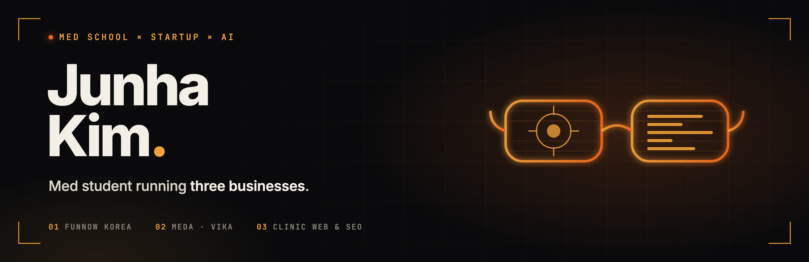

**Med student · founder · building in public. I run my companies, my studies and my life on Claude Code.**

## Now

- **Co-founder, FunNow Korea** — bringing [FunNow](https://www.myfunnow.com/), Taiwan's last-minute lifestyle booking app (10M+ users, 7 markets), to Korea. I own the medical side: Korean aesthetic medicine as the revenue core, lifestyle bookings as the traffic engine.
- **Founder, MEDA** (ME + DATA) — a data company for aesthetic medicine.
  - **VIKA** — turns the aesthetic-medicine Reels and posts foreigners actually watch into a normalized procedure database, so visitors can understand and book Korean clinics. Government-backed (Startup Leading University program).
  - **MEDIT** — a Substack and chat community for people in and around medicine.
- **Clinic Web & SEO** — a bundled website + search + content package for clinics, sold as "renew it free, then let word of mouth do the selling."
- **M2, Yeungnam University College of Medicine** — yes, at the same time.

## How I work

- **One operator, many systems.** Decks, clinic site drafts, Instagram card news, mail triage, calendars, journaling: each is a Claude Code skill or a script, not a task I repeat.
- **Tools before agents.** Automation means fewer tokens, not more agents. A zero-token script decides whether there is anything new; an agent is called only when judgment is needed. If the agent keeps doing the same thing, that part becomes a script.
- **Numbers and failures in the open.** The sales pitch that failed, the two competitions I lost, the follower count on day one. Build-in-public only works if the losses are posted too.

## Projects

- **[E.D.I.T.H](https://github.com/Allowe1/E.D.I.T.H)** — *Even Dead, I'm The Hero.* My personal AI chief of staff on Claude Code: daily brief, mail lanes, calendar, timetable from a PDF, people map, journal, delegation to Codex and Gemini, and a `tune` skill that rewrites its own rules from conversation. Public, scrubbed copy of the system I actually live in.
- **David** (private) — the same engine, built first for a friend. Consent-gated notes, a maintainer mode, and a replication guide. E.D.I.T.H is its fork.
- **Deck & portfolio builders** (private) — pptxgenjs pipelines that turned a 19-slide IR deck and a six-deck design portfolio into reproducible scripts.
- And a few I can't talk about yet.

## Stack

## Elsewhere

Daegu ⇄ Seoul, Korea · [junhakim33@gmail.com](mailto:junhakim33@gmail.com)
